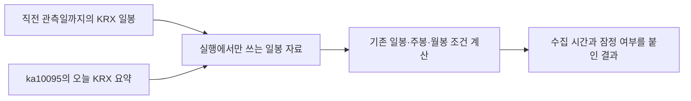

# 키움 REST API로 전 종목의 당일 시세를 받는 방법

확인일: 2026-11-12. API 제공 범위는 공개된 공식 API 가이드와 키움 공식 저장소로 확인했다. 연결 방안은 현재 프로젝트의 코드와 ADR을 분석해 제안했다. 인증정보를 읽거나 실제·모의 키움 시세 API를 호출하지 않았다. 아래의 값은 필드 정의이며 실제 시장 자료가 아니다.

후속 인터뷰에서 확정한 기능 규칙의 원본은 [spec #216](https://github.com/Soochol/vallythevally/issues/216)이다. 이 문서는 API 조사 근거와 기존 코드의 연결 지점을 보존한다.

## 결론

**전 종목의 당일 시가·고가·저가·현재가·거래량·거래대금은 분봉 전체를 받지 않고 `ka10095`로 여러 종목씩 조회할 수 있다.** 현재 공식 이름은 **지정종목 정보요청**이며, 응답 배열 이름은 기존의 `atn_stk_infr`(관심종목정보)다. 종목코드를 직접 지정하므로 사용자가 HTS에 저장한 관심종목에 한정되는 요청이 아니다. [ka10095 공식 명세](https://openapi.kiwoom.com/m/guide/apiguide/01/ka10095), [공식 예제](https://github.com/Kiwoom-Securities/Kiwoom-REST-API/blob/c7a3d25449ed4b4238bef378780c41103c67b9e9/examples/국내주식/종목정보/get_domestic_watchlist_stock_info.py)

이 API의 응답 항목은 당일 요약값을 만드는 데 필요한 형태다. 다만 공개 명세가 응답의 일자와 누적값이 바뀌는 정확한 시각, 시간외 거래 포함 범위, 한 요청의 모든 종목을 같은 시점에 읽는다는 보장까지 제공하지는 않는다. **필드 제공 여부와 거래 세션의 정확한 의미는 구분해야 한다.** [ka10095 공식 명세](https://openapi.kiwoom.com/m/guide/apiguide/01/ka10095)

## ka10095의 요청과 필드

`POST /api/dostk/stkinfo`에 헤더 `api-id: ka10095`를 사용한다. 본문은 `stk_cd`이며, 여러 종목은 `|`로 구분한다. KRX는 접미사 없는 코드, NXT는 `_NX`, 통합은 `_AL`이다. 응답에서 필요한 배열은 `atn_stk_infr`다. [공식 명세](https://openapi.kiwoom.com/m/guide/apiguide/01/ka10095)

| 목적 | 필드 | 공식 설명·단위 |
|---|---|---|
| 종목 식별 | `stk_cd` | 종목코드 |
| 시가·고가·저가 | `open_pric`, `high_pric`, `low_pric` | 원, 부호가 포함된 숫자 |
| 현재가 | `cur_prc` | 원, 부호가 포함된 숫자 |
| 거래량 | `trde_qty` | 1주 |
| 거래대금 | `trde_prica` | 백만원 |
| 기준가 | `base_pric` | 원 |
| 일자 | `dt` | `YYYYMMDD` |
| 체결시간 | `cntr_tm` | `HHmmss` |

표는 [ka10095 공식 명세](https://openapi.kiwoom.com/m/guide/apiguide/01/ka10095)에 따른다. `cntr_qty`는 별도의 체결량이므로 누적 거래량에 대신 넣지 않는다. `close_pric`(종가)도 있지만 장중 현재가에는 명시적으로 `cur_prc`를 선택한다. `exp_cntr_pric`(예상체결가)는 별도 항목이다.

공식 문서는 `trde_qty`·`trde_prica`를 거래량·거래대금이라고 이름 붙이며, `0B`처럼 필드명에 “누적”을 명시하지 않는다. 당일 누적치로 쓰려면 기존 검증 근거를 유지하되, 시간외 포함 범위까지 문서에서 증명됐다고 쓰면 안 된다. 거래대금은 API가 제공한 백만원 단위를 보존하고, `현재가 × 거래량`으로 대신 계산하지 않는다. [ka10095](https://openapi.kiwoom.com/m/guide/apiguide/01/ka10095), [0B](https://openapi.kiwoom.com/m/guide/apiguide/14/0B)

**공개 공식 명세에서 ka10095의 최대 종목 수는 확인하지 못했다.** 입력의 `Length: 20`은 최대 종목 20개라는 설명이 아니며, 실시간 조건검색 결과의 100종목 제한도 이 API의 제한을 증명하지 않는다. 공식 예제는 여러 코드를 받지만 최대 개수 검증을 하지 않는다. 프로젝트의 100개 묶음 정책과 이미 남아 있는 검증 근거는 공식 문서상의 보장과 따로 적어야 한다. [공식 명세](https://openapi.kiwoom.com/m/guide/apiguide/01/ka10095), [공식 예제](https://github.com/Kiwoom-Securities/Kiwoom-REST-API/blob/c7a3d25449ed4b4238bef378780c41103c67b9e9/examples/국내주식/종목정보/get_domestic_watchlist_stock_info.py), [공식 유량 안내](https://openapi.kiwoom.com/intro)

## 다른 조회 API와의 비교

| API | 공식 응답에서 확인한 내용 | 전 종목 당일 조회에 대한 판단 |
|---|---|---|
| `ka10001` 주식기본정보요청 | 현재가, 시가·고가·저가, 거래량. 거래대금과 시세의 일자·체결시간 필드가 없다. | 여섯 값 전체를 이 요청 하나로 채울 수 없다. [명세](https://openapi.kiwoom.com/m/guide/apiguide/01/ka10001) |
| `ka10004` 주식호가요청 | 호가와 호가잔량 중심이다. | 필요한 OHLCV·거래대금 요약을 대신하지 못한다. [명세](https://openapi.kiwoom.com/m/guide/apiguide/01/ka10004) |
| `ka10005` 주식일주월시분요청 | `stk_ddwkmm` 배열에 날짜, OHLC, 거래량, 거래대금(백만원)이 있다. | 단일 종목 요청이다. 요청에 봉 주기나 기간 선택 인자가 없고, 응답 행의 주기·장중 갱신 보장이 명확하지 않아 우선 선택할 이유가 적다. [명세](https://openapi.kiwoom.com/m/guide/apiguide/01/ka10005) |
| `ka10006` 주식시분요청 | 날짜, OHLC, 거래량, 거래대금(백만원)을 준다. | 단일 종목이며 시각 필드가 없다. “시분”이라는 이름만으로 1분봉 또는 당일 스냅숏의 정확한 의미를 확정하지 않는다. [명세](https://openapi.kiwoom.com/m/guide/apiguide/01/ka10006) |
| `ka10007` 시세표성정보요청 | 현재가·OHLC·거래량·거래대금(백만원), `date: YYYYMMDD`, `tm: HHmmss`를 준다. | 한 종목의 날짜·시간을 포함한 대안이다. 전 종목에는 종목 수만큼 요청이 든다. [명세](https://openapi.kiwoom.com/m/guide/apiguide/01/ka10007) |
| `ka10081` 주식일봉차트조회요청 | 종목·기준일·수정주가 구분을 받고, 일자별 OHLCV와 거래대금(백만원)을 준다. | 첫 페이지에서 오늘 행을 찾아 쓰면 분봉은 필요 없다. 그러나 단일 종목 요청이고 페이지 행 수를 1로 제한하는 인자가 없다. [명세](https://openapi.kiwoom.com/m/guide/apiguide/01/ka10081) |

`ka10081`의 `base_dt`는 기준일자이지 “오늘 봉이 반드시 있다”는 보장이 아니다. 첫 행을 무조건 오늘로 취급하지 않고 `dt`를 확인해야 한다. 공개 필드 명세에서 오늘 행의 장중 갱신 주기, 요청별 최대 행 수, 조회 시점의 세션 범위를 보장하는 문구는 확인하지 못했다. 오늘 한 행이 필요할 때 과거 페이지를 끝까지 연속조회할 이유는 없다. [ka10081 공식 명세](https://openapi.kiwoom.com/m/guide/apiguide/01/ka10081)

## 실시간 0B는 필요한 누적 필드를 제공하지만 전체 종목 구독에는 한도가 있다

`0B` 주식체결은 `10` 현재가, `16` 시가, `17` 고가, `18` 저가(각 원), `13` 누적거래량(1주), `14` 누적거래대금(백만원)을 준다. `15` 거래량은 매수체결 양수·매도체결 음수인 개별 체결량이다. 장중에 이미 만들어진 누적 필드를 이용할 수 있으므로 당일의 모든 체결이나 분봉을 다시 합칠 필요는 없다. 다만 등록 직후 반드시 초기 자료가 전달되는지와 재접속 중 빠진 체결의 재전송은 이 필드 명세로 보장되지 않는다. [0B 공식 명세](https://openapi.kiwoom.com/m/guide/apiguide/14/0B)

등록은 `REG`와 종목 배열 `item`을 사용하고 거래소별 코드 접미사는 REST 조회와 같다. `20`은 `HHmmss`인 체결시간이며 날짜 필드는 없다. `290`은 장전 시간외·장중·장후 시간외 구분, `9081`은 `KRX`·`NXT`인 거래소 구분이다. 시간 문자열만으로 서버 수신일의 체결이라고 판단하거나 통합 구독의 모든 누적 필드를 KRX 누적치로 해석해서는 안 된다. [0B 공식 명세](https://openapi.kiwoom.com/m/guide/apiguide/14/0B)

현재 공식 안내는 계좌별(토큰별) 세션 1개, 세션당 실시간 시세 200종목이라고 정한다. 그룹을 늘리면 계좌의 200종목 제한을 피할 수 있다는 근거는 없다. 따라서 약 4천 종목의 전 종목 스크리너를 계속 `0B`로 구독하는 방안은 이 제한과 맞지 않는다. [공식 유량 안내](https://openapi.kiwoom.com/intro)

## 키움 조건검색과 순위 API는 별도의 대안이다

키움 조건검색은 영웅문4(Windows)에서 만든 조건식을 조회한다. `ka10171`은 저장된 조건식 목록, `ka10172`는 일반 검색 결과, `ka10173`은 실시간 편입·이탈을 받는다. 앱 자체의 조건 종류·최근 M봉·주봉과 월봉 집계 규칙을 그대로 실행하는 API라는 보장은 없다. [공식 조건검색 안내](https://openapi.kiwoom.com/m/guide/ai?guideNum=07), [목록 명세](https://openapi.kiwoom.com/m/guide/apiguide/01/ka10171), [일반 명세](https://openapi.kiwoom.com/m/guide/apiguide/01/ka10172), [실시간 명세](https://openapi.kiwoom.com/m/guide/apiguide/01/ka10173)

`ka10172`는 현재가·시가·고가·저가·누적거래량을 주지만 누적거래대금 필드는 없다. 일반 검색에는 `cont_yn`·`next_key`가 있다. 현재 포털은 거래소에 `K:KRX, A:통합`을 안내하지만 아래의 고정된 공식 JSON에는 `K:KRX`만 있어 문서 버전 차이가 있다. [일반 검색 명세](https://openapi.kiwoom.com/m/guide/apiguide/01/ka10172), [공식 JSON 고정본](https://github.com/Kiwoom-Securities/Kiwoom-REST-API/blob/c7a3d25449ed4b4238bef378780c41103c67b9e9/kiwoom/_data/kiwoom_api_spec.json)

공식 이용안내의 실시간 조건검색 한도는 국내 10건이고 결과 최대 100종목이다. 이 안내와 일반 검색의 연속조회가 함께 있으므로 모든 조건검색 형태의 전체 결과 한도가 정확히 어떻게 적용되는지는 별도 확인 대상이다. 이 수치를 일반 시세의 100종목 묶음 제한으로 옮겨 쓰지 않는다. [공식 이용안내](https://openapi.kiwoom.com/intro)

`ka10030` 당일거래량상위와 `ka10032` 거래대금상위는 여러 종목의 현재가·거래량·거래대금을 준다. 거래소는 `stex_tp: 1`로 KRX를 고른다. 그러나 두 응답 모두 시가·고가·저가가 없고, 순위·대상 필터를 거친 목록이 전체 대상 종목을 빠짐없이 포함한다는 보장은 확인하지 못했다. 거래량·거래대금 순위가 목적이면 사용할 수 있지만 앱 스크리너의 전체 종목 자료를 대체하지는 못한다. [ka10030 명세](https://openapi.kiwoom.com/m/guide/apiguide/01/ka10030), [ka10032 명세](https://openapi.kiwoom.com/m/guide/apiguide/01/ka10032)

## 호출 한도와 남은 확인 사항

현재 공식 안내의 국내주식 조회 한도는 **계좌별(토큰별) 초당 5회**다. 주문도 별도로 초당 5회이며, 모의투자는 같은 TR당 초당 1회다. 이 값은 앱의 보수적인 요청 간격이나 ADR 0010에 적힌 초당 4회 가정과 구분한다. 묶음 수를 줄여도 차트 등 다른 조회와 같은 계좌의 조회 예산을 나눈다는 점은 남는다. [공식 유량 안내](https://openapi.kiwoom.com/intro), [ADR 0010](adr/0010-screener-reads-a-disk-daily-store.md)

공식 명세에 없는 아래 사항은 이번 조사로 확정하지 않았다.

- `ka10095`의 공식 최대 종목 수, 응답 누락·무거래·거래정지·장전 상태의 상세 계약.
- `dt`와 `cntr_tm`이 무거래 종목에서 언제 바뀌며, 휴장일·다음 날 장전에는 어느 관측일을 나타내는지.
- KRX 당일 OHLC·누적 거래량·거래대금에 장전·장후·애프터마켓이 포함되는 정확한 범위와 초기화 시각. KRX 코드 선택은 확인했지만 “KRX 정규장만”이라는 뜻까지 증명하지는 못했다.
- 여러 종목이 같은 원자적 시점에 읽히는지, 가격과 누적값의 시점이 같은지, 거래대금 백만원 값의 반올림·절사 방식.
- 공식 JSON과 현재 포털의 차이, 실시간 조건검색 결과 제한과 일반 검색 연속조회 사이의 정확한 관계.

날짜·체결시간·서버 수신시각은 각기 다른 정보다. “조회 완료 시각” 하나를 모든 종목의 마지막 체결시각으로 표시하는 것은 위 문서가 제공하는 보장을 넘는다. 이는 확인된 필드와 미확인 동작을 구분한 설계상의 판단이다.

## 조사 근거

2026-11-12의 공개 포털 HTML에서 관련 TR의 요청·응답 표를 확인했다. 함께 읽은 공식 저장소의 현재 `main`은 커밋 `c7a3d25449ed4b4238bef378780c41103c67b9e9`였고, `kiwoom/_data/kiwoom_api_spec.json`에서 API ID로 교차 확인했다. 실제 시세 조회, 인증, 실시간 등록 또는 성능 측정은 하지 않았다. 따라서 호출 개수·간격으로 추산한 시간은 실측 성능이 아니다. [공식 API 가이드](https://openapi.kiwoom.com/m/guide/apiguide), [공식 스펙 고정본](https://github.com/Kiwoom-Securities/Kiwoom-REST-API/blob/c7a3d25449ed4b4238bef378780c41103c67b9e9/kiwoom/_data/kiwoom_api_spec.json)

## 현재 코드에는 당일 요약을 받는 경로가 이미 있다

아래 내용은 현재 코드에서 확인한 사실이다. 앞의 공식 명세와 구분한다.

- [`StockQuotes`](../crates/server/src/kiwoom/api.rs)는 `ka10095`를 호출하고 종목을 최대 100개씩 `|`로 묶는다. 생성자 시험은 100개 허용·101개 거부를 확인한다. 코드에는 101개 요청이 1634로 거절됐다는 기존 관측 기록이 있다. 이번 조사에서 이를 다시 실제 호출하지 않았다.
- [`Screener::recent`](../crates/server/src/screener/update.rs)는 이미 이 요청을 KRX로 보내 최근 하루를 채운다. 과거가 직전 관측일까지 있으면 요약 한 행을 일봉으로 저장하고, 여러 날짜가 빠졌으면 일봉 API로 보충한다.
- [`QuoteRow`와 `parse_krx_quotes`](../crates/server/src/kiwoom/wire.rs)는 필요한 OHLCV·거래대금·기준가·날짜를 이미 읽는다. 다만 `KrxDayQuote`는 응답의 `cntr_tm`을 보존하지 않는다. 기존 시험에는 마감 뒤 `ka10095`와 `ka10081`의 같은 날짜 OHLCV·거래대금이 일치하는 고정 입력이 있다. 이것이 모든 장중 세션의 일치를 증명하지는 않는다.
- [`Calendar::target`과 `Screener::judge`](../crates/server/src/screener/mod.rs)는 오늘 확정 전에는 이전 관측일까지 저장·판정한다. [`Period`의 확정 규칙](../crates/domain/src/period.rs)은 20시 뒤 10초 유예를 둔다. [`before_20_00_the_update_stops_at_the_last_day_before_today`](../crates/server/tests/screener_update.rs)는 키움이 오늘 행을 줘도 오후 업데이트에서 저장하지 않는 기존 동작을 시험한다.
- [`engine.rs`](../crates/server/src/screener/engine.rs)는 DuckDB의 `daily`를 읽어 일봉 조건을 계산하고, 주봉·월봉은 같은 일봉을 집계한다. [`Condition`](../crates/server/src/api.rs)의 현재 봉 조건들은 가격 네 값·거래량·거래대금을 사용한다. 시가총액 조건은 가격과 별도로 종목 목록의 상장주식수를 사용한다.
- [`quotes.rs`](../crates/server/src/quotes.rs)의 현재가 경로는 통합 시세를 요청한다. 이 응답을 그대로 KRX 스크리너에 넣으면 거래소 기준이 달라진다. [`DayTotals`](../crates/server/src/kiwoom/stream.rs)는 현재 등락·누적거래량만 보존하며, 실시간 OHLC·누적거래대금은 보존하지 않는다.

## 권고는 확정 일봉과 당일 요약을 합쳐 기존 계산기를 쓰는 것이다

후속 설계 인터뷰에서 KRX 시세 반영·일봉과 주봉과 월봉 반영·수동 실행마다 새로 수집하는 방침·봉 위치와 봉 범위·별도 실행 기준 선택을 두지 않는 구성·자료 누락과 수집 실패 처리를 확정했다. 자동 변환은 변경 안내 없이 진행하며, 조건들은 각자 봉 범위에서 독립적으로 확인한다. 기능 규칙은 [spec #216](https://github.com/Soochol/vallythevally/issues/216), 결정의 이유는 [ADR 0014](adr/0014-screener-includes-current-krx-day.md)에 기록했다. 아래는 기존 코드와 연결하는 방법을 설명하며, 기능은 아직 구현하지 않았다.

직전 관측일까지의 확정 이력에 오늘 요약 한 행을 종목별로 붙여 계산한다. 장중의 일봉 종가 자리에는 현재가를 넣는다. 기존 조건의 계산을 재사용하므로 신고가·거래대금 범위·이동평균 위치·RSI 등을 계산할 수 있다. 과거 자료 없이 오늘 여섯 값만으로 이동평균이나 RSI를 계산할 수 있다는 뜻은 아니다. 별도의 실행 기준 선택 없이 실행할 때 최신 자료를 반영한다. 휴장일처럼 새 봉이 원래 없으면 기존 마지막 봉이 계속 0이며, 이 경우는 조회 실패와 구분한다.

조건은 봉 위치 범위로 확인한다. 0~0은 마지막 봉 하나, 1~1은 그 앞의 봉 하나, 0~2는 마지막 세 봉 중 하나라도 맞으면 된다. 양 끝의 봉을 모두 포함하며 각 조건을 따로 판단한다. 일봉·주봉·월봉 조건은 오늘 요약을 반영한 현재 봉을 사용하지만, 새 봉이 원래 없는 종목은 기존 마지막 봉이 계속 0이다. 현재 봉이 확정됐다는 뜻으로 표시하지 않는다. [조건·봉 범위 정의](../GLOSSARY.md)

봉 위치는 기준 관측일까지의 마지막 봉이 0, 그 앞의 봉이 1이다. 달력의 오늘을 0으로 고정하지 않는다. 시간 오름차순으로 봉이 10개 있으면 10번째 봉이 0, 9번째 봉이 1이며, 새 봉이 추가되면 새 봉이 0이 되고 기존 봉의 번호가 1씩 커진다. 같은 봉의 값만 갱신되면 번호는 바뀌지 않는다.

봉 위치·검색 범위·신고가와 신저가의 비교 기간·지표 기간은 모두 실제 봉 개수로 센다. 거래가 없어 봉이 생기지 않은 날은 건너뛴다. 기존 `line.rs`의 신고가·신저가 창은 관측일 칸으로 계산하므로, 이 부분도 구현 범위에 포함된다. 기존 [무거래·누락 관측일 시험](../crates/server/tests/screener_run.rs)의 기대 결과를 새 규칙에 맞춰 변경해야 한다.

거래정지처럼 새 봉이 원래 생기지 않은 종목도 마지막으로 존재하는 봉을 0으로 검색한다. 봉 날짜를 결과에 표시하고, 제외 여부는 기존 대상 종목 설정으로 고른다. 조회 실패나 해석 불가능한 행을 원래 봉이 없는 경우로 처리하지 않는다.

현재 코드의 M은 위치가 아닌 최근 봉의 개수다. 기존 조건식은 최근 M봉을 0~(M-1) 범위로 자동 변환하고, 이름과 조건 값은 유지한다. 변환에 관한 변경 안내는 표시하지 않는다. 저장된 조건식은 SQLite의 `screens` 한 행에 JSON 배열과 `revision`으로 보관한다. 기존 [중첩 조건식 변환](../crates/server/migrations/0006_screen_condition_kinds.sql)처럼 새 형식으로 한 번 옮기는 방식이 가능하다.

각 조건은 자기 범위에서 독립적으로 확인한다. 신고가가 1봉에서 맞고 거래 급증이 0봉에서 맞아도 두 조건을 모두 만족한다. 맞은 날짜는 기존처럼 첫 번째 봉 조건이 가장 최근 맞은 봉의 날짜를 사용한다.

자료 흐름은 아래와 같다.

당일 요약은 메모리에 별도로 보관하고 계산할 때 확정 일봉과 결합한다. 실행용 임시 표로 전달하면 기존 DuckDB 조회 경로에 연결할 수 있다. DuckDB의 확정 `daily`와 `store_meta.last_day`를 장중에 바꾸지 않는다. 실행에서 쓰는 공통 일봉 자료를 만들고 조건 계산·달력·확인 여부·결과 가격·시가총액 계산이 모두 그 자료를 보게 한다. `bar_query`만 바꾸면 다른 경로가 어제 가격을 사용하는 문제가 남는다. 오늘 확정 일봉이 저장된 뒤에는 요약을 중복 합산하지 않는다.

이 설계는 [ADR 0010](adr/0010-screener-reads-a-disk-daily-store.md)의 확정 이력을 보존하지만, 그 ADR의 '스크리너는 저장소만 읽는다'는 결정에는 예외를 추가한다. 이 범위 변경은 후속 인터뷰에서 [ADR 0014](adr/0014-screener-includes-current-krx-day.md)으로 기록했다. 구현에 앞서 기능 규칙과 시험을 spec 이슈에 옮긴다.

### 여섯 시세 값에 기준가와 시각을 함께 보존한다

시세 값은 질문의 여섯 항목으로 현재 봉 조건을 계산할 수 있다. 다음 정보는 판정과 결과 표시를 위해 함께 필요하다.

- 종목코드와 거래소. 1차 범위는 과거 이력과 같은 KRX로 고정한다.
- `dt`와 `cntr_tm`. 오늘 행인지 확인하고 마지막 체결 시각을 남긴다. 체결이 뜸하다는 이유만으로 수집 실패라고 판단하지 않는다.
- 서버의 종목별 수신시각과 전체 수집 시작·완료시각. 오래된 체결과 오래된 조회를 구분한다.
- `base_pric`. 기준가 대비 등락과 이전 봉 종가 대비 변화를 구분하고 수정 사건을 확인할 때 쓴다. 이번 스크리너 결과의 등락률과 `Change(back=1)` 조건은 기존처럼 일봉의 직전 거래 봉 종가와 비교하며, 기준가 대비 등락으로 바꾸지 않는다. [기준가·정규장 종가 정의](../GLOSSARY.md)
- 수집 묶음 식별자와 누락·실패 상태. 서로 다른 실행의 자료를 섞지 않고 누락 종목 수를 표시한다.

시가총액 조건에 필요한 상장주식수는 현재 종목 목록에서 재사용할 수 있다. 오늘 OHLCV에 주식수가 포함된 것은 아니며, 종목 목록이 바뀌면 판정도 다시 해야 한다. 거래대금은 기존 `MillionWon`과 같은 단위로 유지한다.

### 첫 버전은 수동 실행마다 새로 수집한다

설계 인터뷰에서 실행 버튼을 누를 때마다 오늘 요약을 새로 받고 조건식을 계산하기로 정했다. 수집 중인 실행들은 진행 중인 수집 하나를 함께 사용하고, 수집이 끝난 뒤 새로 실행하면 다시 받는다. 결과는 다음 실행까지 유지한다. 앞서 제안했던 짧은 기간 동안의 완료 자료 재사용은 첫 버전에 적용하지 않는다. 자동 수집도 첫 버전의 범위에서 제외한다.

ADR의 약 3,960종목 규모를 예로 들면 현재 100개 묶음 정책으로 40회 요청이다. [`SEND_SPACING=260ms`](../crates/server/src/kiwoom/rest.rs)에 따른 첫 전송과 마지막 전송 사이의 간격만 `39 × 260ms = 10.14초`다. 응답시간·차트 요청·다시 보내기는 여기에 추가된다. 실제 수집 시간을 측정한 수치는 아니다. 결과에는 단일 시각 대신 수집 시간 범위를 표시한다.

수집은 한 작업만 진행하고 중복 실행은 그 작업을 함께 기다리게 한다. 완료한 자료 묶음을 한 번에 교체하고, 판정 하나는 그 묶음을 끝까지 사용한다. 중간 요청이 실패하면 일부만 새 자료인 묶음을 정상 결과로 내보내지 않는다. 이전 결과를 남기는 경우에는 이전 수집 시간과 갱신 실패를 표시한다. 한 종목의 행 누락·해석 실패는 그 종목을 별도로 세고, 어제 자료를 오늘 자료로 대신 쓰지 않는다.

휴장일·장전·무거래·거래정지는 기존 관측일 달력과 응답 날짜·거래 상태를 함께 사용해 구분한다. 자정이 지나면 전날 요약을 오늘 자료로 재사용하지 않는다. 확정 이력도 필요 관측일까지 없으면 기존처럼 업데이트를 요구한다. 수정 사건이 의심되는 종목은 기존 재수집 경로와 연결하고, 수정 전 이력에 수정 후 현재가를 붙여 정상 판정하지 않는다. 기존 30% 감지만으로 모든 수정 사건을 찾을 수 있다고 가정하지 않는다.

### 화면과 결과에는 잠정 판정이라는 점을 드러낸다

[`ScreenerResult`](../crates/server/src/api.rs)는 지금 기준 관측일만 가진다. 수집 시간 범위·당일 자료 누락 수를 추가하는 방식을 제안한다. 결과 가격은 0봉의 최신 가격을 표시하고, 조건이 맞은 날짜와 종목의 봉 날짜는 별도로 표시하기로 확정했다. [`ScreenerPanel`](../web/src/features/screener/ScreenerPanel.tsx)은 현재 `종가`와 맞은 날짜를 표시하므로 함께 검토해야 한다. [`screener` 상태 저장](../web/src/stores/screener.ts)은 현재 조건식과 확정 저장소 버전으로 결과를 구분하므로, 당일 자료 묶음도 구분해야 한다. 실행 기준을 고르는 별도 모드는 두지 않는다.

오늘 현재가로 계산한 이평 교차나 RSI 돌파는 다음 조회에서 취소될 수 있다. 오늘 고가가 어떤 가격을 넘었는지는 요약으로 알 수 있지만, 현재가·지표가 장중 언제 교차했으며 그 뒤 어떻게 움직였는지는 복원할 수 없다.

## 당일 요약으로 충분한 조건과 추가 이력이 필요한 조건

| 원하는 검색 | 필요한 자료 |
|---|---|
| 오늘 신고가·신저가, 가격 범위, 현재 RSI·이평 조건 | 저장된 일봉 이력과 오늘 여섯 값 |
| 오늘 거래대금 100억원 이상, 직전 N일 평균 거래량의 K배 | 같은 자료. 오늘 값은 조회 시점까지 쌓인 값으로 비교 |
| 현재가 대비 시가 변화, 갭, 고가에서 밀린 정도 | 오늘 요약과 기준가 등. 일부 조건 종류는 새로 추가해야 함 |
| 어제 같은 시각 대비 거래량 배수 | 과거의 시각별 누적거래량. 일봉 이력과 오늘 요약만으로는 계산 불가 |
| 최근 5분 거래대금, 장중 이평의 교차 순서 | 분봉이나 충분히 촘촘한 체결·요약 이력 |
| 장중 특정 조건이 한 번이라도 맞았는지 | 조건에 따라 장중 이력이나 지속 판정 기록이 필요. 고가·저가만으로 판정 가능한 조건은 예외 |

거래량·거래대금을 장의 경과 시간에 단순 비례시켜 예상 최종값을 만드는 기능은 1차 범위에서 빼는 것을 권한다. 같은 시각 대비 거래 급증이 필요해지면 오늘 요약을 시각별로 쌓는 별도 기능을 검토할 수 있다. 다만 그 방식도 수집 전 과거의 시각별 자료를 만들어 주지는 않는다.

## 구현 범위와 검증

확정 규칙과 완료 기준은 [spec #216](https://github.com/Soochol/vallythevally/issues/216)에 옮겼다. 작업은 [당일 요약 수집 #217](https://github.com/Soochol/vallythevally/issues/217), [봉 범위·자동 이전·실제 봉 판정 #218](https://github.com/Soochol/vallythevally/issues/218), [실행 결합 #219](https://github.com/Soochol/vallythevally/issues/219), [결과 화면·통합 E2E #220](https://github.com/Soochol/vallythevally/issues/220)으로 나눴다. #218은 #207을 기다리지 않고 현재 편집기에 봉 범위를 최소 변경으로 반영한다. 이후 #207은 새 계약과 검증을 재사용한다. #219는 #217·#218 뒤, #220은 #219 뒤에 진행하도록 native blocked-by로 연결했다. 키움 HTS 조건검색으로 계산기를 바꾸는 대신 기존 조건 계산을 재사용한다.

실제 키움 API를 부르지 않고 fake-kiwoom으로 다음 동작을 확인한다.

- 오늘 값이 달라지면 같은 조건식의 결과가 바뀌고, 현재가가 되돌아오면 잠정 교차도 사라진다.
- 일봉과 이번 주·이번 달 집계에 오늘 값이 한 번만 들어간다. 확정 일봉 저장 뒤에도 중복되지 않는다.
- 봉 위치 0이 마지막 봉을 가리키며, 새 봉 추가와 같은 봉의 값 갱신을 구분한다. 최근 여러 봉의 검색 범위와 맞은 날짜는 인터뷰에서 확정한 규칙에 맞춰 확인한다. 거래량 0인 날의 기존 의미도 함께 확인한다.
- 거래대금 단위가 맞고, 결과 등락률과 이전 봉 대비 변화 조건은 기존 봉 비교 의미를 유지한다. 기준가와 직전 봉 종가가 다른 경우도 확인한다.
- 첫 요청 실패와 중간 요청 실패, 행 누락·지난 날짜·거래정지·휴장일·날짜 변경을 구분한다.
- 동시 실행·취소·갱신 실패·확정 이력 업데이트 중에도 다른 자료 묶음이나 어제 자료가 오늘 결과에 섞이지 않는다.
- 수정 사건이 의심되는 종목은 이력 정합성을 확인하기 전에 정상 결과로 내보내지 않는다.

이번 작업은 코드와 공식 문서 조사, 설계 인터뷰, 문서·spec·작업 티켓 작성까지 진행했다. 위 기능을 구현하거나 코드 시험을 실행하지 않았다.

## PR 1의 읽기 계약과 경계

`server::screener::summary::SummaryCollector`는 기존 실행 API에 연결하지 않은 메모리 수집기다. `collect`에 전체 대상 종목 목록을 넘기면 정렬·중복 제거하고, KRX 100개 묶음으로 공통 키움 대기열의 화면 우선순위와 반복 예산을 사용한다. 반환한 `Arc<SummaryBatch>`는 이후 수집·취소에도 바뀌지 않는다. 묶음에는 식별자, 대상 KST 날짜, KRX 거래소, 시작·완료시각, 코드별 수신시각과 결과가 있다. 날짜·체결시각은 `KrxSummary`에 따로 보존한다. 시고저종·거래량은 `Ohlcv`, 거래대금은 `MillionWon`, 기준가는 `Price`다.

같은 날짜·대상 목록으로 수집 중 들어온 호출은 같은 작업과 결과를 공유한다. 순서와 중복만 다른 목록도 같은 목록이다. 다른 대상 목록은 `TargetsChanged`로 거절하므로 호출자는 이전 작업의 종료를 기다린 뒤 재시도한다. 날짜가 바뀐 뒤의 호출은 기존 작업을 `DateChanged`로 끝내고 새 날짜로 시작한다. 완료 후 호출은 새로 수집한다. 대기자 하나를 버리는 것은 다른 대기자를 취소하지 않으며 `cancel`은 모든 대기자에게 `Cancelled`를 전달한다. 취소 뒤의 요청은 별도 대기열 병합 범위를 사용하므로 이전 HTTP 응답과 합쳐지지 않는다.

한 요청이라도 실패하거나 예상하지 않은 연속조회가 있거나 수집 도중 날짜가 바뀌면 새 완성 묶음을 게시하지 않는다. `CollectionError::Kiwoom`에는 기존 관문·전체 멈춤·경로 멈춤과 재개시각이 그대로 남는다. `completed`는 마지막 성공 묶음을 원래 날짜·시간과 함께 읽는 용도이며 자동 재사용 경로가 아니다. 실패·취소 후에도 이를 보존하므로 후속 실행 계층은 이 값을 새 실행의 성공 자료로 취급하면 안 된다. 확정 이력의 동시 변경 검사는 #219의 실행 결합 계층이 담당한다. 이 수집기는 DuckDB를 읽거나 쓰지 않는다.

정상 HTTP 응답의 누락·해석 실패·중복 코드·다른 날짜는 종목별 오류로 보관한다. 요청 순서와 응답 순서는 같다고 가정하지 않는다. 다른 거래소 접미사와 요청하지 않은 코드는 결합하지 않는다. 중복 코드 행은 임의로 하나를 고르지 않고 그 종목을 제외한다. 날짜가 없거나 잘못되거나 오늘과 다르면 무거래로 확정하지 않는다. 휴장·장전의 전 관측일 행도 `OtherDate`로 남겨 후속 계층이 달력과 함께 판단하게 한다.

공식 세션 초기화를 가정하지 않기 위해, 오늘 날짜에 거래량·거래대금·시가·고가·저가가 모두 0으로 확인되는 행만 `NoTrades`로 구분한다. 이때 현재가 0도 보존하고 봉을 만들지 않는다. 체결시각은 빈 값이면 `None`이며 잘못된 비어 있지 않은 값은 해석 실패다. 양수 거래량 행은 유효한 체결시각·양수 OHLC·OHLC 관계가 필요하다. 확정 업데이트 파서와 달리 잘못된 OHLC를 넓혀 고치지 않는다. 오래된 유효 체결시각은 수신이 오래되었다는 뜻이 아니므로 배제하지 않는다. 위의 중복·대상 변경·무거래 확인 기준은 불명확한 응답을 정상 봉으로 만들지 않기 위한 PR 1의 보수적인 경계다.

합성 자료는 `fake_kiwoom::summary::row`와 `set_quote_rows`로 날짜·시각·장중값·응답 순서·누락을 제어하고, `script`의 요청별 상태·본문·지연으로 최초·중간 실패와 늦은 응답을 만든다. 기존 `KrxMarket` 확정 일봉 경로는 이 설정을 하지 않으면 그대로다.
