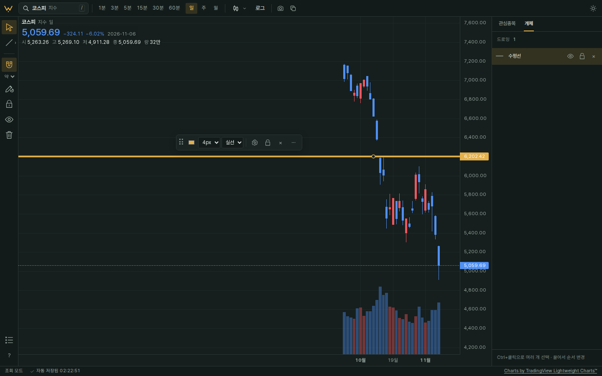
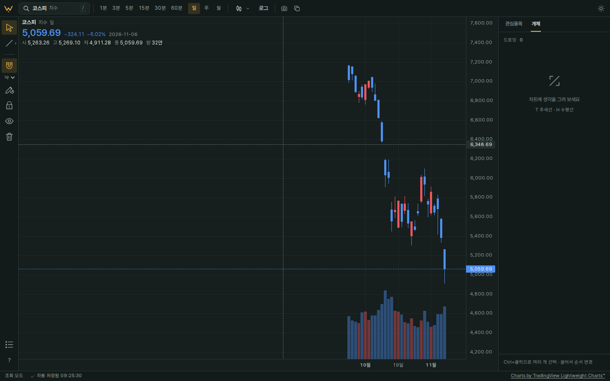

# 예약된 미전송 의도의 늦은 게시 경합 검증

2026-11-10 KST. 원래 실패 커밋은 `d5c85ef434e1ed2612cb498d7c4455c79a65c67e`, 수정 코드는 `44925edba19e7a423503d1a62f5d9d8dea57de0f`다. 실제 앱·HTTP·SQLite 결과와 native Storage·Web Locks 어댑터 결과를 구분한다. 이전 F1~F7 증거는 [review-fixes.md](review-fixes.md)에 있다.

## 원래 R1 입력과 결과

저장된 수평선을 두 탭에서 연다. A가 굵기4를 선택할 때 UUID의 **첫 native pending setItem 바로 전**에 같은 origin의 동기 XHR gate로 멈춘다. 순서와 PUT revision은 이미 예약돼 있다. B가 같은 선을 삭제하고 저장 완료를 기다린다. 이때 실제 DB와 pending·shared 키는 비어 있고 전송은 B의 DELETE뿐이어야 한다. A를 재개한 뒤에도 DB가 비어 있어야 한다.

- 수정 전 자연시계 재현은 옛 PUT1794244970613보다 새 DELETE1794244970747이 크다. gate를 푼 뒤 첫 PUT이 새로 전송돼 굵기4 행이 다시 생겼고 최종 부재 assertion이 실패했다.
- 수정 후 같은 입력은 옛 PUT1794270330775보다 새 DELETE1794270330899가 크다. gate 전후 전송은 DELETE 한 건이며 DB와 pending·shared 키는 계속 비어 있다. 같은 id의 완료 기록 한 개가 옛 순서를 거절할 근거로 남는다.
- 최종 부재 assertion을 화면 존재 여부나 단위 시험으로 바꾸지 않았다. [실제 앱 회귀](../../../web/e2e/publication-regression.spec.ts)가 HTTP 목록과 DB 결과를 확인한다.

첫 화면은 수정 전 A 탭의 재생성 결과다. 둘째 화면은 수정 후 DELETE 탭이다. 화면만으로 다른 탭이나 DB의 부재를 추정하지 않고, 실제 전송·SQLite assertion을 판정 근거로 쓴다.

## warm Storage와 전송 경계

Storage를 먼저 사용한 같은 동기 작업은 다른 문서의 새 값을 못 볼 수 있다. 등록을 먼저 쓰고 단일 origin floor를 읽는 B 초안은 이 경계에서 실패해 제품에 넣지 않았다. 실패 초안·패치·trace와 대안 조사는 코디네이터의 외부 증거 폴더에 보존했다.

최종 제품에는 등록·전역 floor·producer·readiness 상태가 없다. 최소 저널의 UUID 예약 앞에 시험용 native 등록 gate를 넣어 같은 warm 읽기와60초 뒤진 시계를 재현한다. 낮은 예약값을 바꾸지 않은 채 비동기 승인에서 남아 있는 id별 완료 근거로 거절한다. 실제 B의 원래 등록 gate를 그대로 둔 별도 격리 control에서도 완료 기록만 추가하면 같은 warm 반례가 사라짐을 확인했다. 이 control은 최종 제품 구조가 아니다.

마지막 유효성 확인부터 native fetch 시작까지 짧은 per-id 잠금으로 묶는다. 별도 실제 앱 시험은 PUT 시작 직전 gate에서 DELETE 승인이 기다리는지, PUT이 시작된 뒤에는 그 ACK가 아직 보류돼도 DELETE가 진행하는지 확인한다. HTTP 응답·목록 조회를 잠금 안에서 기다리지 않는다.

## 보관·오류·이관 계약

- 같은 id는 마지막 완료 order·UUID와 별도 revision 최대값 한 기록을 단조 갱신한다. 삭제된 id도 만료 없이 보관한다. 용량 압박이나 TTL을 이유로 정리하지 않는다.
- 완료 기록 쓰기가 실패하면 pending을 지우지 않고 저장 실패를 표시한다. 실제 앱 quota 시험은 ACK 뒤 오류와 두 복구 키 보존, 재시도 뒤 추가 PUT 없이 정리됨을 확인한다.
- native 어댑터는 완료 쓰기 전 삭제0회, 여러 옛 stage와 최신 stage·shared 각각의 정리 실패, reload 뒤 옛 의도 재전송 차단, UUID 동률, 더 최신·다른id 보존, 읽기·잠금·메타데이터 오류를 검사한다. 이 결과를 HTTP·SQLite 증거로 세지 않는다.
- v1 이관은 per-id 잠금 안에서 정확한 기존 값과 최신 상태를 확인한다. 예약된 revision을 보존하며, legacy 제거 실패 뒤 reload해도 첫 이관의 UUID·revision을 다시 예약하지 않는다. 고유 stage가 없는 v2 공유 기록은 다시 만들지 않는다. 이미 완료한 내용을 v1으로 재주입하면 PUT 없이 정리한다. 완료 근거가 없는 구버전 origin fixture는 예약 revision731을 그대로 전송해 서버의 새 revision831에409를 받고 새 행을 보존한다.
- 새 보장은 구버전 드로잉 문서를 모두 종료하고 새 버전으로 다시 연 뒤부터다. 구버전 실행 코드를 새 클라이언트가 차단하거나 이미 사라진 과거 완료 이력을 복원할 수는 없다. 사용자 탭을 자동으로 닫는 기능은 없다.
- 이미 전송된 옛 PUT이 DELETE 뒤 도착하면 서버 묘비 생략에 따라 행이 다시 생길 수 있다. 서버 DELETE·묘비 정책은 바꾸지 않았다.

집중 실행은 원래 `scripts/offline.sh`, 명시적 fake REST·WS, `chromiumSandbox:true`를 사용했다. 전체 검사는 원래 pre-push hook의 `scripts/check.sh` 경로로 확인한다. 네이티브 screenshot·hotkey·menus 지원 제한과 직접 손 입력 감각은 여전히 미확인이다. 위 화면은 Playwright 캡처이며 네이티브 메뉴 검증을 뜻하지 않는다.
