# 레이아웃 통합 마무리 검증

사용자가 도킹과 캔버스를 오가며 여러 창을 분석해도 배치·종목 연동·드로잉과 키보드 초점이 이어지는지 확인했다. PR은 [#375](https://github.com/Soochol/vallythevally/pull/375)다.

검증한 최종 HEAD는 `d796bb937e54baf132a75950d7c7af1cc2b024c6`, 반영한 원격 main은 `c400e65131dd20e8d05eea2a8c6998c644c2e093`다. 최종 검사 두 실행은 모두 clean HEAD이며 시작·종료 source 지문이 `a7ab225d06038d6c1077f85cae96ce205a28b567d3573f9165e4ba13a7be2db4`로 같다. [실제 manifest 요약](final-manifests.json)에 기록했다.

## 실행한 검사

```sh
python3 scripts/web.py check src/layout src/features/workspace/manage.test.ts src/stores/layout.test.ts src/persist
python3 scripts/web.py e2e e2e/win-journey.spec.ts e2e/win-shell.spec.ts e2e/win-manage.spec.ts e2e/win-link.spec.ts e2e/win-layouts.spec.ts e2e/win-dock.spec.ts e2e/win-crosshair.spec.ts e2e/win-canvas.spec.ts e2e/win-float.spec.ts e2e/restore.spec.ts e2e/close-while-saving.spec.ts e2e/float-shell.spec.ts
```

타입 검사와 단위 시험 292개, E2E 159개가 통과했다. 새 `win-journey.spec.ts`는 43개다. 지정 회귀에 정확한 셸 자리 검사를 보강한 `float-shell.spec.ts` 4개도 포함했다. 전체 시험과 병합은 오케스트레이터의 병합 검사에 맡겼다. 실제 서버·키움·DART와 Rust 전체 시험은 실행하지 않았다.

## 고친 결함

| 잘못된 동작 | 수정과 확인 |
|---|---|
| Tab으로 가려진 캔버스·떠 있는 창 머리에 들어가도 뒤에 남는다. | 실제 사용자 초점은 창을 앞으로 보이고 활성 칸을 따른다. 두 방식의 노출·초점 테두리·머리 버튼·Shift+Tab을 검사했다. |
| 창 머리나 닫기 버튼을 키보드로 닫으면 초점이 사라진다. | 이미 노출된 남은 머리·선택된 탭·위 막대에서 후속 대상을 고른다. 활성 칸·배치·기록은 그대로다. |
| 자동 초점 복귀가 별도 배치 단계를 만들어 닫기 되돌리기를 무효화한다. | 코드가 복귀시킨 초점의 동기적 대상을 구별한다. 한 번의 되돌리기로 원래 창 목록과 배치가 정확히 돌아오는지 검사했다. |
| 초점이 가려진 도킹 탭이나 화면 밖의 선택하지 않은 탭으로 돌아간다. | 실제 노출을 확인하고 선택된 탭은 탭 줄 안에서만 드러낸다. 1024px의 차트 탭 8개 상황도 검사했다. |
| 뒤 창의 크기 조절을 Esc로 취소해도 창 순서가 바뀐다. | 프로그램의 복귀는 창을 활성화하지 않는다. 두 방식에서 위치·크기·순서와 배치 기록이 정확히 같은지 검사했다. |
| 닫기 직후 정상 Tab으로 고른 새 버튼 초점을 예약 콜백이 가져간다. | 초점이 body에 사라진 경우에만 복귀한다. 프레임을 멈추지 않은 실제 Delete→Tab 24회에서 원본의 관측 10건이 수정 후 0건이 됐다. 버튼·입력·잃은 초점의 대조 회귀도 두 방식에서 검사했다. |

gpt-6-astra와 gpt-6.1-sol이 별도 worktree의 실제 브라우저에서 검토하고, 발견한 문제를 고친 리비전을 다시 실행했다. 최종 HEAD는 검사한 코드와 동일하고 완료 표시만 더했음을 두 리뷰어가 확인했다. 남은 검증된 지적은 없다. gpt-6.1-terra의 no-comments도 최종 HEAD에서 추가 주석·억제 지시문·HOLD·MUST KILL이 모두 0개다.

## 정리와 타입 경계

`rg -n "RightPanel|rightPanel|watchCollapsed|panelWidth|activeSlot|symbolLink" web/src`의 [실제 결과](legacy-keys.txt)는 옛 UI 키 폐기와 그 시험, 옛 저장 모양 거절 시험뿐이다. `RightPanel`, `activeSlot`, `--chart-right`는 남아 있지 않다. 참조가 없는 `SunIcon`, `MoonIcon`, `ChevronRightIcon`을 지웠다.

임시 창 종류를 생성 DTO에 넣으면 종류 표 누락을 타입 검사가 지적했다. 종류 표까지 채우면 창 내용·아이콘·기본 크기 표 누락을 지적했다. [실험 요약](type-probe.json), [첫 단계 컴파일 오류](type-kind-missing.log), [두 번째 단계 오류](type-content-missing.log)가 근거다. 임시 변경은 원복했고 새 종류는 추가하지 않았다. Rust 저장 match의 exhaustiveness는 소스에서 확인했으며 Rust 컴파일을 실행했다고 주장하지 않는다.

설계 문서의 화면 틀·도킹·캔버스·떠 있는 창·연동·메뉴를 한 흐름으로 정리했다. 빈 옛 배치를 읽자마자 저장하지 않는 규칙, 지표 창과 드로잉 도크의 뜻도 바로잡았다. 용어집과 ADR은 현재 모양에 맞췄다. 승인 플랜은 완료 표시 외 [본문을 바꾸지 않았다](plan-body-check.txt).

## 화면과 범위

아래 12장은 같은 최종 E2E의 합성 Scenario 응답으로 캡처했다. 실제 시세 자료가 아니다. 원본의 크기와 해시는 [스크린샷 목록](screenshots.json)에 있다. 1024×768·1280×720·1440×900·1280×300의 두 방식, 390×844, 키보드와 감소 미디어 설정을 시험했다. 이는 Chromium의 실제 입력·노출 검사이며 화면 읽기 프로그램 전체 감사를 뜻하지 않는다.

처음 캔버스로 옮긴 긴 창의 몸통은 아래 창 종류 줄에서 잘릴 수 있다. 창 크기를 줄이면 저장한 비율과 최소 크기를 함께 유지해 일부 창이 겹칠 수 있다. 이 기존 정책을 캡처와 문서에 구분해 남겼다. 같은 브라우저의 원래 묶음 힌트는 다른 기기에 동기화하지 않는다. 드로잉 선 간헐 실패·겹침 스타일·서버 거래소 타입은 지정된 후속 작업이다.

| 장면 | 1440×900 | 1024×768 |
|---|---|---|
| 기본 도킹 | 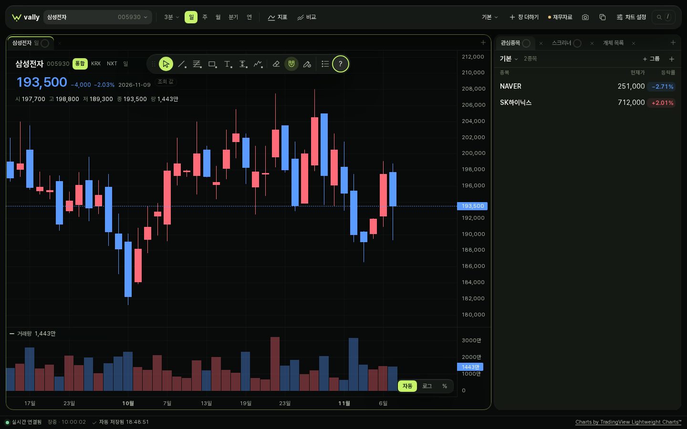 | 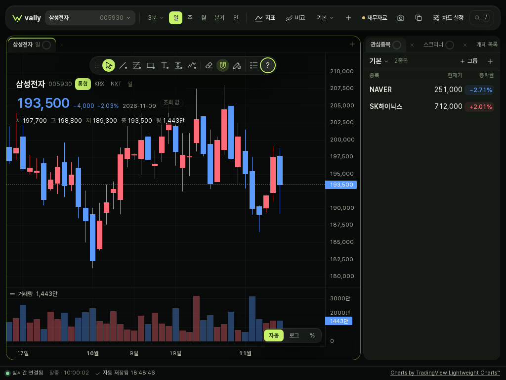 |
| 기본 캔버스 | 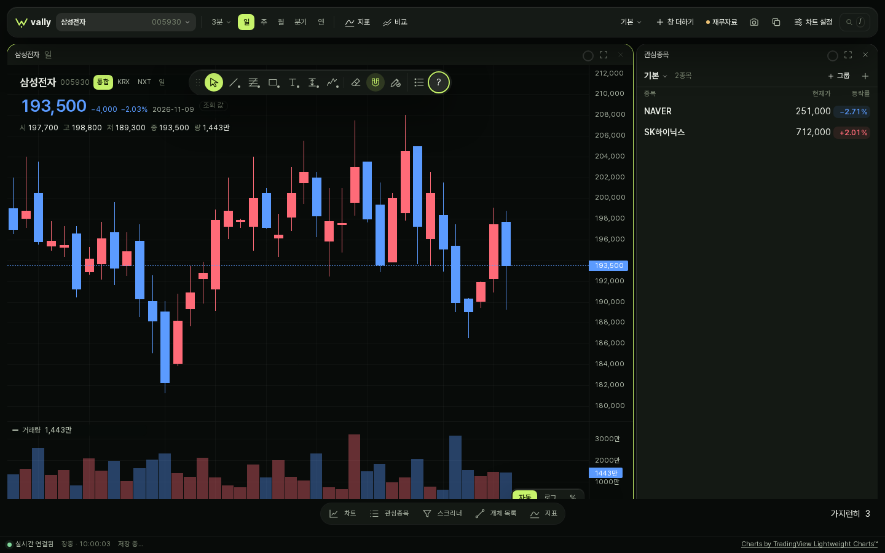 | 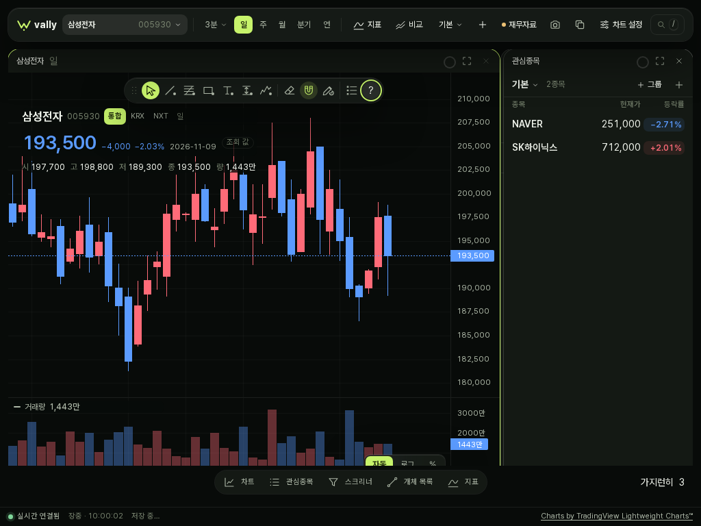 |
| 차트 넷과 옆 창의 도킹 | 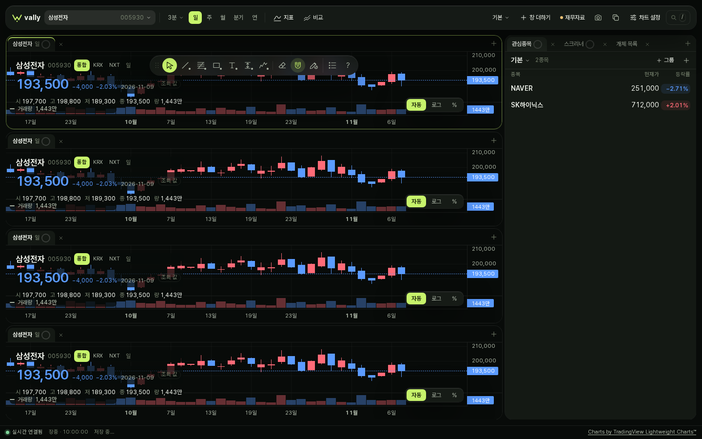 | 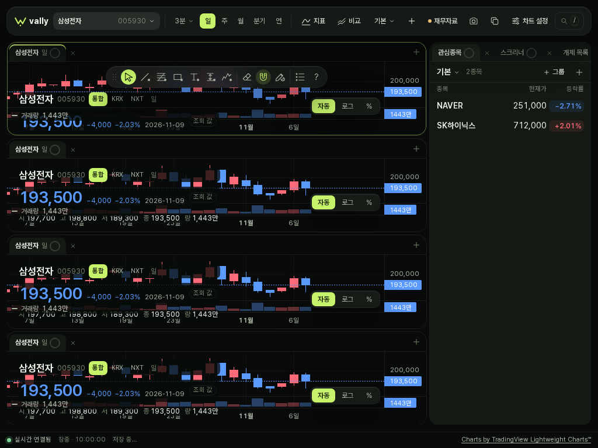 |
| 차트 넷과 옆 창의 캔버스 | 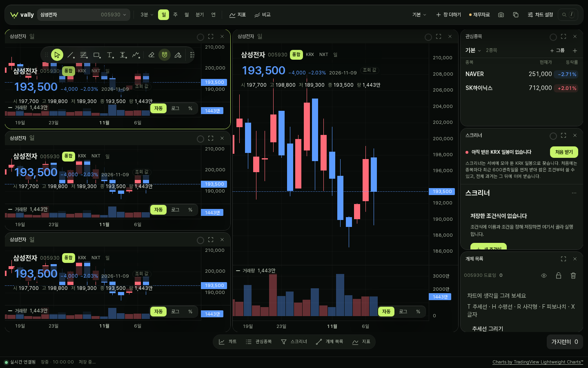 | 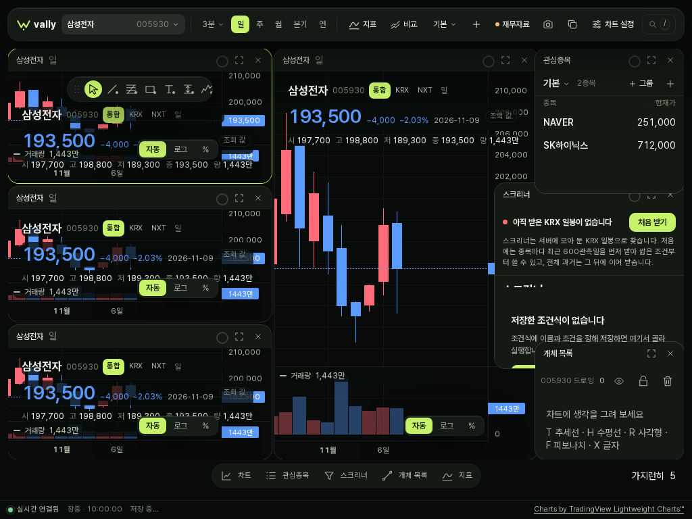 |
| 떠 있는 도킹 창 | 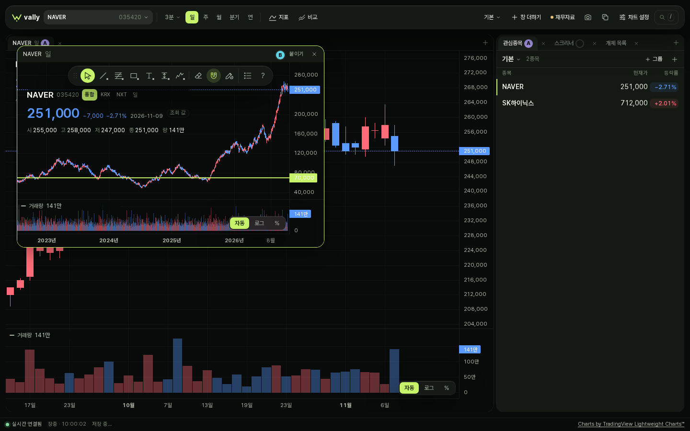 | 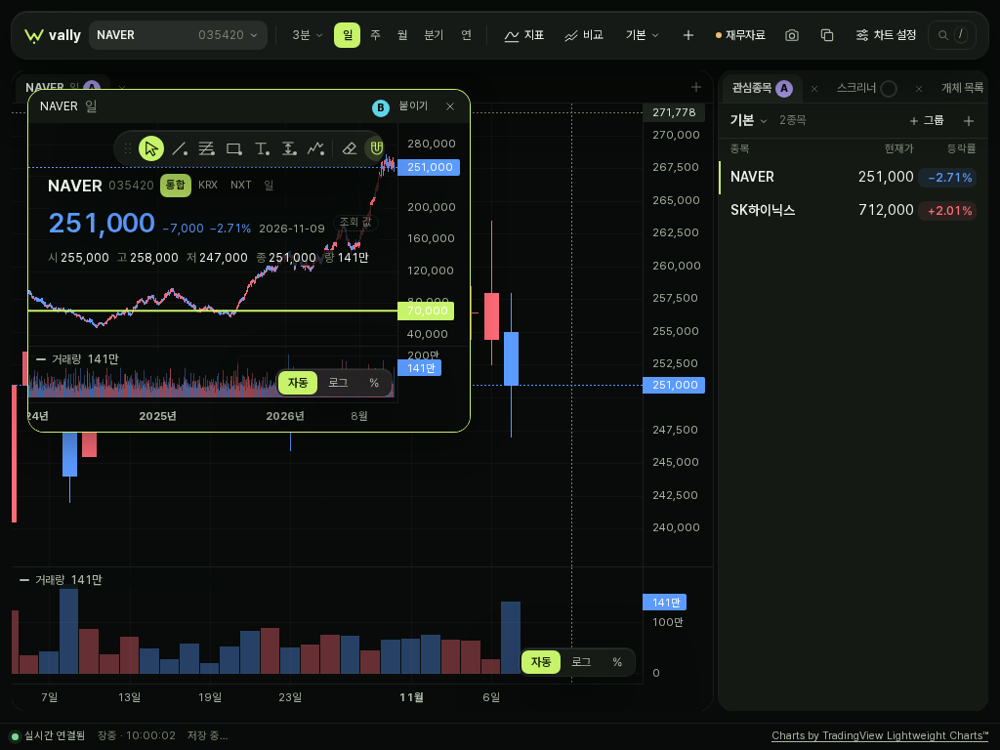 |
| 겹친 캔버스 | 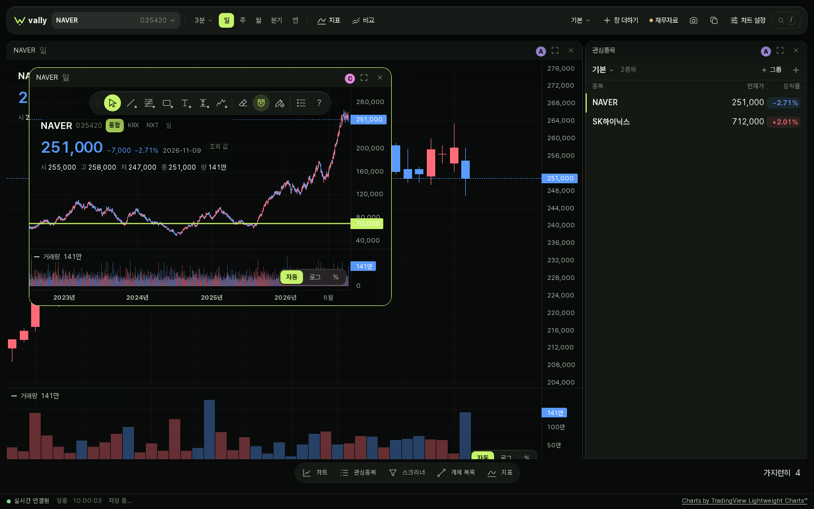 | 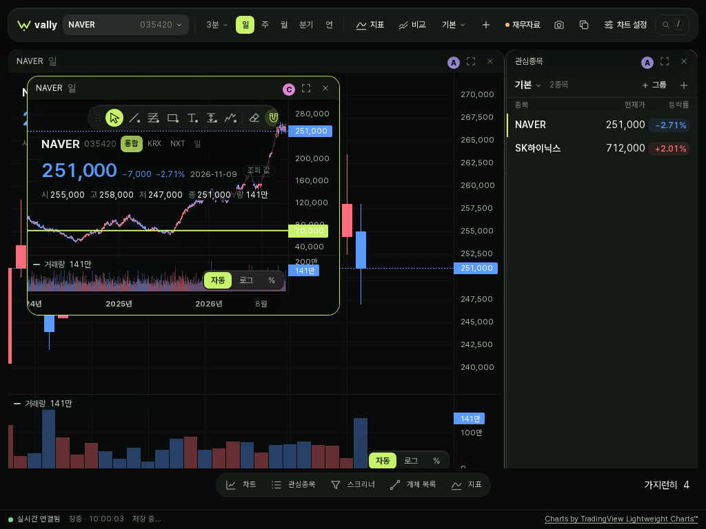 |
